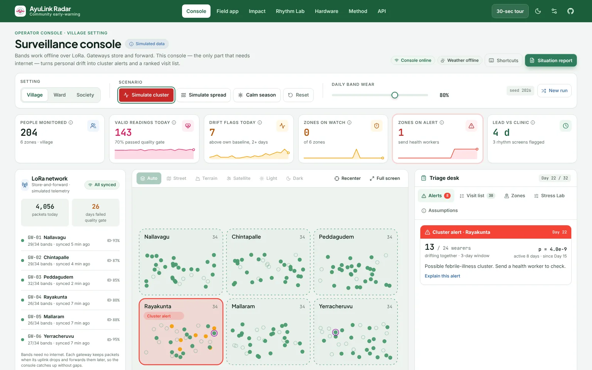
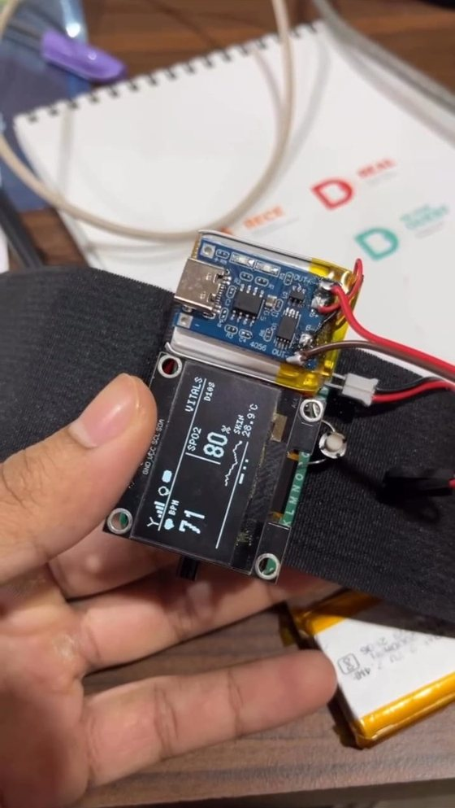
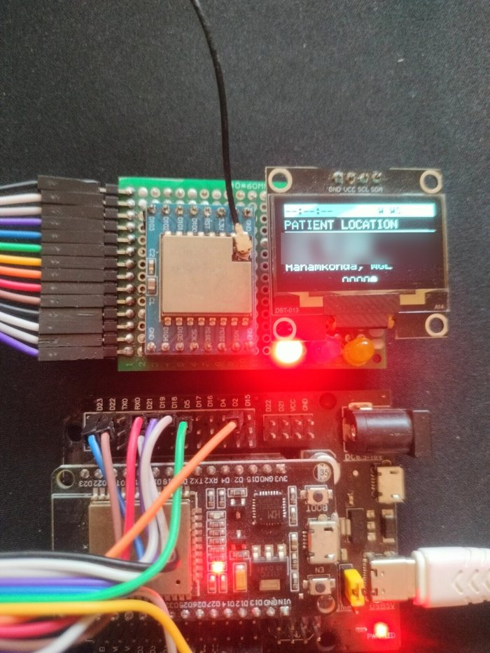
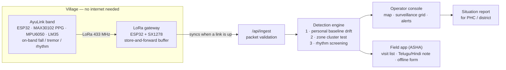
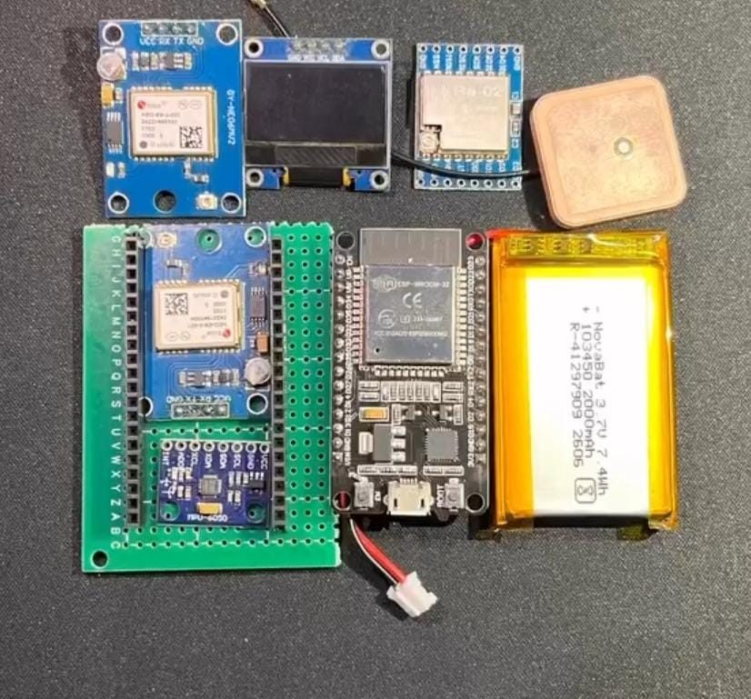
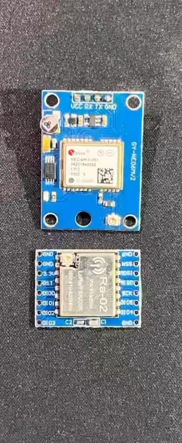
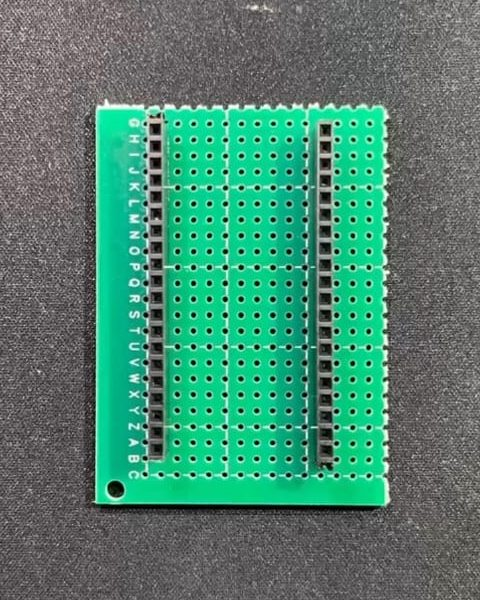
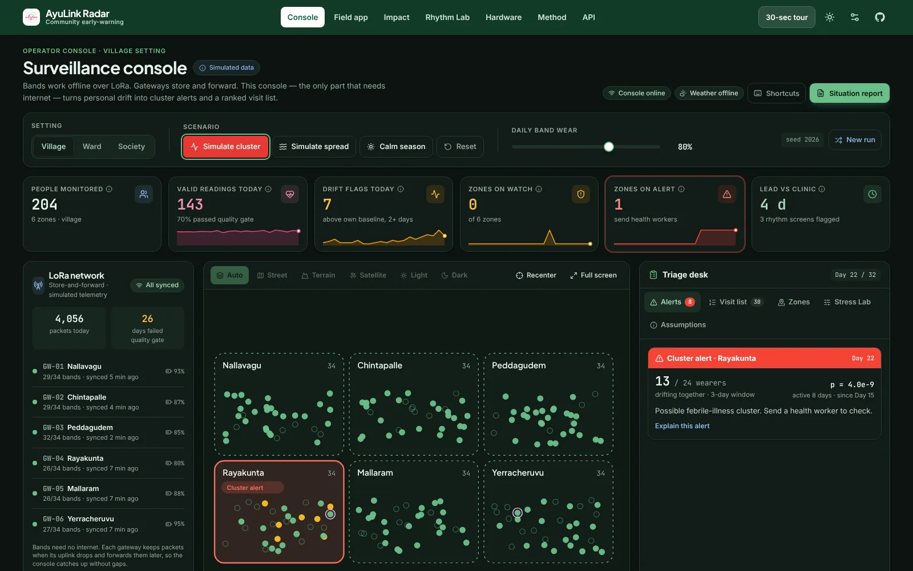
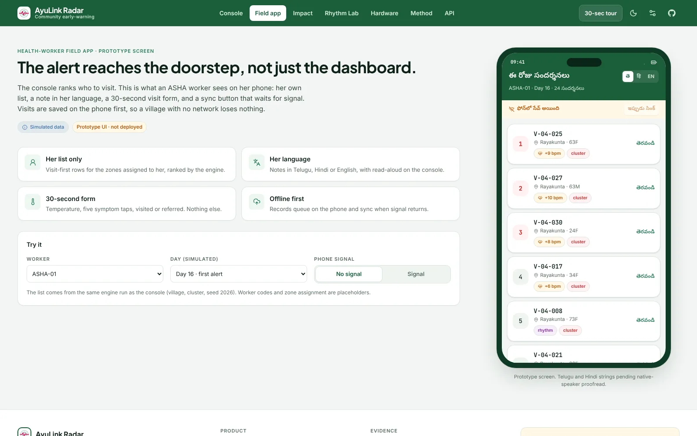
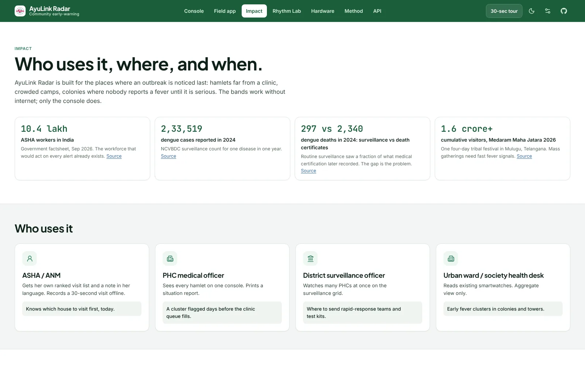

<div align="center">

# AyuLink Radar

### See an outbreak before the clinic does.

A community early-warning system for India. Low-cost wristbands learn each person's normal
resting heart rate. When several people in one hamlet drift up **together**, the console raises a
cluster alert and hands the health worker a ranked visit list, days before clinic reports.
Bands work **offline over LoRa**. Only the operator console needs internet.

**INNOVEX 2026 · PS 01 — AI-Powered Healthcare:** *"Develop intelligent solutions for early disease detection and accessible healthcare."*

[](https://github.com/siddharthathula/ayulink-radar/actions/workflows/ci.yml)


**[▶ Live demo](https://ayulink-radar.vercel.app)** · **[30-second guided tour](https://ayulink-radar.vercel.app/demo?tour=1)** · **[Field app](https://ayulink-radar.vercel.app/field)** · **[API](https://ayulink-radar.vercel.app/api-docs)**

<!-- TODO before submission: confirm the live URL above matches your Vercel deploy, add the 90-second video link and team member names. -->

</div>

> **Screening prototype. Not a medical device. Not clinically validated.**
> Population data in the demo is **simulated**. The wristband and LoRa gateway hardware are real
> bench prototypes. Every number in this README is produced by a script in this repository.



<table>
<tr>
<td width="50%" align="center"><br><b>AyuLink wristband</b> — our bench prototype. Heart rate, SpO2, skin temperature, motion. Real photo.</td>
<td width="50%" align="center"><br><b>AyuLink LoRa gateway</b> — receives band packets with no internet. Real photo (GPS digits blurred).</td>
</tr>
</table>

## In one minute

| | |
|---|---|
| **The problem** | Fever outbreaks are noticed only after sick people reach a clinic. In villages far from a PHC, that is days too late. |
| **The idea** | Everyone's heart beats a little faster when an infection starts. One person's rise means little. **Many people in the same hamlet rising together** is a warning. |
| **What we built** | A wristband + LoRa gateway (real hardware), a detection engine, a trained rhythm model, an operator console, a field app for ASHA workers, and an API. |
| **Where** | Shown around **Hyderabad**: rural Rangareddy hamlets, 8 towns from Patancheru to Uppal, and apartment towers in the Financial District. |
| **Result (simulated)** | In a village with 80% daily band wear, **97.5%** of seeded clusters were caught, a median **3 days** before simulated clinic detection. |
| **Honest limit** | Population data is simulated. Needs ≥ 60% daily wear. Not a medical device. |

---

## Contents

1. [A story from the monsoon](#1-a-story-from-the-monsoon)
2. [The problem](#2-the-problem)
3. [Our solution](#3-our-solution)
4. [What is new](#4-what-is-new--and-what-is-not)
5. [How it works](#5-how-it-works)
6. [Results](#6-results)
7. [Feasibility](#7-feasibility)
8. [Use cases: who, where, when — around Hyderabad](#8-use-cases-who-where-when--around-hyderabad)
9. [Scalability: from one PHC to all of India](#9-scalability-from-one-phc-to-all-of-india)
10. [Hardware](#10-hardware) · [Product tour](#product-tour)
11. [How this meets the judging criteria](#11-how-this-meets-the-judging-criteria)
12. [Run it yourself and deploy](#12-run-it-yourself-and-deploy)
13. [Limitations, privacy and safety](#13-limitations-privacy-and-safety)
14. [Roadmap](#14-roadmap)
15. [References](#15-references)

---

## 1. A story from the monsoon

> *This is an illustrative story. The people and the hamlet are fictional composites, not a real
> case. It shows the kind of gap AyuLink Radar is built for.*

It has rained for nine days in a forest hamlet two hours from the nearest Primary Health Centre.
**Lakshmi**, the ASHA worker, covers 212 people across three hamlets on foot.

On Monday, a farmer tells her his son has "a little fever". On Tuesday, two women at the hand-pump
mention body pain. On Wednesday an old man stays in bed. Nobody goes to the PHC; the road is
flooded, a day's wages is a day's wages, and fevers come every monsoon.

The PHC's weekly report shows nothing unusual. The first patient from the hamlet reaches the clinic
on **Saturday**: a 9-year-old girl, **Divya**, too weak to stand. By then eleven people in her hamlet
are sick. A medical team arrives the next week. Divya spends four nights in the district hospital.

Every one of those people had a heart that was beating faster than *their own* normal, days before
anyone counted them.

**The same week, with AyuLink Radar.** On Tuesday evening, eight band wearers in Divya's hamlet are
drifting above their personal baselines at once. The console turns the hamlet amber, then red.
Lakshmi's phone shows a ranked list: *visit these six houses first*, with a note in Telugu. On
Wednesday morning she checks temperatures, finds four fevers, and the PHC sends a team with test
kits **on Thursday**: two days before the first clinic visit, while it is still a small cluster.

That gap — between when a community starts getting sick and when the health system finds out — is
what we are trying to close.

---

## 2. The problem

**Outbreaks are counted after people get sick enough to be counted.**

India's disease surveillance (IDSP, digitised as IHIP) is built on reports from health facilities
and field workers. It is real and it works, but it starts when a sick person reaches a clinic or
an ASHA notices and reports. Three things make that late:

| Gap | What happens | Evidence |
|---|---|---|
| **Surveillance starts at the clinic** | Clusters grow quietly before the first patient arrives. | Routine passive reporting suffers from under-reporting and poor timeliness [ICMR-NIE, ref 6]. |
| **What is counted is a fraction of what happens** | In 2024, surveillance recorded **297** dengue deaths; medical certification of cause of death recorded **2,340** [ref 7]. | Surveillance sees a fraction of the real burden. |
| **No device means no early signal** | Wearable-based illness tracking is proven, but only for affluent smartwatch owners, mostly in the USA [refs 1–3]. | People with no smartwatch and no nearby clinic produce no early signal at all. |

The burden is not small: **2,33,519** dengue cases were reported in India in 2024 [ref 8], and
fevers are no longer confined to the monsoon months [ref 8].

**The question we answer:** *can a cheap wristband and a community-level detector give a health
worker a few days' warning, in places with no internet, without pretending to diagnose anyone?*

---

## 3. Our solution

AyuLink Radar has three detection layers and one action layer.

| Layer | What it does | In plain words |
|---|---|---|
| **A · Personal baseline drift** | Each person's resting heart rate is compared with their **own** 21-day median, not a population average. A drift flag needs 2+ days clearly above normal. | "Your heart has been beating faster than *your* normal for 2 days." Often an early sign of fever or infection. |
| **B · Community cluster alert** | For each zone, a binomial test asks: are *more people drifting together* than chance allows? Bonferroni-corrected, with a region-wide guard so a heatwave is not mistaken for a local outbreak. | "Eight of 24 people in this hamlet are drifting at once. That is very unlikely to be chance." |
| **C · Irregular-rhythm screening** | A trained model scores 30-beat windows of beat-to-beat intervals for irregular rhythm (atrial-fibrillation-like patterns). Runs in the browser and as a C header on the ESP32. | "This person's pulse looks irregular. Refer for an ECG." |
| **D · Action** | A ranked **visit-first list**, a short **note in Telugu, Hindi or English**, a **field app** for the ASHA, and a printable **situation report** for the PHC. | "Visit these six houses first. Here is what to check." |

**What it never does:** name a disease, diagnose, or suggest medicine. Every flag is labelled
*screening flag, not a diagnosis*.

---

## 4. What is new — and what is not

We did not invent wearable illness detection. We are honest about that.

| | Population-level detection | Per-person baseline | Works offline | Low-cost band | Health-worker output |
|---|:-:|:-:|:-:|:-:|:-:|
| Scripps / Fitbit studies (USA) [refs 1–3] | ✓ (state level) | ✓ | ✗ | ✗ (consumer watches) | ✗ |
| Hospital bedside monitors (e.g. contactless mattress sensors) | ✗ | — | — | ✗ | Nurse alert |
| LoRa vitals bands in research papers | ✗ | not stated | ✓ | ✓ | SMS alert |
| **AyuLink Radar** | **✓ (hamlet / town / tower)** | **✓** | **✓ LoRa** | **✓** | **✓ ranked list + local-language note** |

**Our contribution** is the combination, built for India's last mile:
1. A **population layer** that turns individual wearables into a community cluster detector at hamlet scale.
2. **One engine, three settings**: village (own band + LoRa), city (bands + smartwatches across a metro), housing society (existing smartwatches, aggregate-only).
3. **ASHA-first output**: what to do, who first, in her language, usable offline.
4. **One model, three runtimes**: the rhythm model is trained in Python, runs in TypeScript in the browser, and exports to a C header for the ESP32 — with parity tests across all three.

---

## 5. How it works



**Detection in four steps**

1. **Quality gate.** A day counts only if the band was worn ≥ 120 minutes at rest with ≤ 30% motion
   artefact. Bad readings are thrown away; a sensor problem can never become a health alert.
2. **Personal baseline.** Median of the person's last 21 valid days (skipping the 2 most recent).
   Robust z-score; a drift flag needs z ≥ 2 on two consecutive valid days.
3. **Cluster test.** In each zone, `k` people flagged in a 3-day window out of `n` eligible
   wearers is tested against the zone's own historical rate with a binomial tail. Watch at
   `p < 0.01/Z`, alert at `p < 0.001/Z` (Bonferroni over `Z` zones). Zones under 10 wearers never
   alert. If more than half of all zones light up on the same day, the day is treated as a
   region-wide shift (heat, festival) and downgraded.
4. **Triage.** People are ranked by drift strength, zone level, rhythm screen and age. Notes are
   fixed templates; an optional LLM may rephrase them, but its output is checked and replaced by the
   template if it names a disease, a medicine, or drops the disclaimer.

Full method: [`docs/method.md`](docs/method.md) and the [Method page](https://ayulink-radar.vercel.app/method).

---

## 6. Results

> These are **simulation** results on held-out test seeds (101–300). Thresholds were tuned only on
> seeds 1–100. Source: [`web/public/data/eval.json`](web/public/data/eval.json), produced by
> [`web/scripts/evaluate.ts`](web/scripts/evaluate.ts). Clinic comparison is a deliberately generous
> simulated baseline (3rd clinic visit from the outbreak zone plus reporting lag).

### Cluster detection at 80% daily band wear (full engine)

| Setting | Clusters detected (95% CI) | Median lead vs simulated clinic | False alerts per zone per 30 days |
|---|---|---|---|
| Village (6 Rangareddy hamlets × 34) | **97.5%** (95.0–99.5) | **3 days** earlier | 0.005 |
| City (8 towns around Hyderabad × 60) | **95.0%** (92.0–97.5) | **1 day** earlier | 0.006 |
| Society (6 Financial District towers × 80) | **94.5%** (91.5–97.5) | **1 day** earlier | 0.013 |

A naive fixed threshold (resting HR ≥ 90 bpm) detected **0%** of village clusters at 80% wear.
Personal baselines are what make cheap sensors useful.

### It only works if people wear the band

| Daily wear (village) | 100% | 80% | 60% | 40% |
|---|---|---|---|---|
| Clusters detected | 95.5% | 97.5% | 71.5% | **1.0%** |

**Below about 60% daily wear the community signal fades.** This is the most important operational
requirement, and the first thing a pilot must measure.

### Stress tests (village, 80% wear)

| Scenario | What we tested | Result |
|---|---|---|
| Fast spread | Higher transmission between neighbouring hamlets | 100% detected, 3 days earlier |
| Isolated illness | Many unrelated sick people, no outbreak | 0.006 false alerts / zone / 30 d |
| Heatwave | +3 bpm for everyone for 5 days | 93% detected, but **0.63 false alerts / zone / 30 d** — the region-wide guard needs work |
| Noisy sensors | Heavy motion and contact artefact | **17% detected** — signal quality matters |

### Irregular-rhythm screening model

Trained on the public **MIT-BIH Atrial Fibrillation Database** (PhysioNet, 25 records, 77,794
windows of 30 beats), evaluated with 5-fold cross-validation **split by patient record**:

| AUROC | Sensitivity | Specificity |
|---|---|---|
| **0.989** ± 0.012 | 95.3% ± 3.3% | 95.6% ± 5.0% |

The band uses an optical pulse sensor, not ECG. **On-band validation is pending.** Source:
[`ml/out/metrics.json`](ml/out/metrics.json).

---

## 7. Feasibility

| Dimension | Status | Detail |
|---|---|---|
| **Technical** | **Built and tested** | Band firmware (ESP32, MAX30102, MPU6050, LM35, SX1278, NEO-6M), LoRa gateway, detection engine, rhythm model, operator console, field app and 4 API endpoints. 23 automated tests including Python ↔ TypeScript ↔ C model parity. |
| **Connectivity** | **Designed for no internet** | Bands → LoRa → gateway with store-and-forward. The console runs entirely in the browser after first load. Only the operator side needs a link, and only to sync. |
| **Operational** | **Fits existing work** | ASHAs already do home visits. AyuLink tells her *which* homes first. The visit form takes about 30 seconds and saves offline. Band charging and wear compliance are the main risks; ASHA visits double as a wear-and-charge nudge. |
| **Economic** | **Costing in progress** | Built from commodity modules (ESP32, MAX30102, MPU6050, SX1278). Per-band bill of materials: *TBD — being costed from our purchase records.* One gateway serves a cluster of hamlets; the software runs on free tiers. |
| **Regulatory & ethical** | **Screening, not diagnosis** | No disease names, no treatment advice, aggregate-only urban view, small zones suppressed, pseudonymous codes only. A real deployment needs consent, data-protection compliance (Digital Personal Data Protection Act, 2023) and an ethics review. |
| **Who would run it** | **Existing system** | Complements IDSP/IHIP; it does not replace them. Integration with ABDM / IHIP is future work. **No government partnership is claimed.** |

---

## 8. Use cases: who, where, when — around Hyderabad

**The demo is set in the Hyderabad region** so judges can recognise the places. Names of real towns
are used only to orient the map; every wearer and every outbreak in the console is **simulated**.

| Console setting | Where on the map | Who wears what | Why this setting matters |
|---|---|---|---|
| **Village** | 6 fictional hamlets in rural Rangareddy, near Chevella | AyuLink bands, LoRa gateway, no internet | Hamlets far from a PHC where fevers are noticed last |
| **City** | 8 real towns around Hyderabad: Patancheru, Kukatpally, Medchal, Secunderabad, Gachibowli, Shamshabad, LB Nagar, Uppal | Half AyuLink bands, half existing smartwatches | One console for a whole metro; see which town lights up first |
| **Society** | 6 apartment towers in the Financial District | Existing smartwatches only, aggregate view | Gated communities and campuses with many wearables already |

Switch between them with the **Village · City · Society** buttons (keys 1, 2, 3). The map can show
**street, terrain, satellite, light or dark** base maps, and you can drag and scroll freely.

**Who uses it**

| User | Uses AyuLink to… | Gets |
|---|---|---|
| ASHA / ANM | follow her own ranked visit list, read a Telugu/Hindi note, record a 30-second visit offline | which house to visit first, today |
| PHC medical officer | watch all hamlets on one console, print a situation report | a cluster flagged days before the clinic queue fills |
| District surveillance officer | watch many PHCs on the surveillance grid | where to send rapid-response teams and test kits |
| Urban ward / housing-society health desk | read existing smartwatches, aggregate view only | early fever clusters in colonies and towers |

**Where it fits**

- **Villages under a PHC** — e.g. Rangareddy, Vikarabad, Sangareddy, Medak around Hyderabad; the core pilot setting.
- **Tribal and forest belts** — Mulugu, Bhadradri Kothagudem, Adilabad: scattered hamlets, weak signal, long walks to a PHC.
- **Cities and their edges** — Hyderabad's fast-growing towns (Patancheru, Medchal, Shamshabad) where new colonies outgrow clinics.
- **Mass gatherings** — e.g. Telangana's Medaram Maha Jatara drew a cumulative **1.6 crore+**
  visitors over four days in 2026 [ref 10]. Temporary camps need fast fever signals.
- **Flood and relief camps**, **residential schools and hostels**, **migrant labour camps**.

**When it matters most**

| Months | Season | Why AyuLink helps |
|---|---|---|
| Jan – Feb | Festivals, winter fevers | Crowded short windows; fast cluster signal |
| Mar – May | Heat season | Region-wide guard separates heat from local outbreaks |
| Jun – Sep | **Monsoon** | Main season for febrile clusters |
| Oct – Nov | **Post-monsoon** | Mosquito-borne fevers often peak after the rains |
| Dec | Quiet | Personal baselines settle before the next season |

More on the [Impact page](https://ayulink-radar.vercel.app/impact).

---

## 9. Scalability: from one PHC to all of India

India already has the people who would act on every alert: **10.4 lakh ASHA workers** [ref 9].
AyuLink adds a signal to their existing routine; it does not need a new workforce.

| Stage | Scope | What we learn |
|---|---|---|
| 1 · Pilot | 1 PHC · ~200 bands · 8 weeks | Real wear compliance, battery life, false-alert rate against the PHC fever register |
| 2 · Block | 5–10 PHCs | ASHA workflow at scale, gateway placement, training time |
| 3 · District | One district surveillance unit | Console beside existing reporting |
| 4 · State | Seasonal deployment in high-risk blocks | Bands move to where the season needs them |

**Why it scales cheaply**

- **Stateless engine.** The same TypeScript runs in a browser tab and in a serverless function.
  More districts means more bands and gateways, not more servers.
- **One engine, any density.** Village, city and society presets share the same code; only zone
  size and data source change.
- **Hardware-agnostic input.** Anything that produces a daily resting heart rate can feed the
  engine: our band, a smartwatch, a future ABDM-linked device.
- **Offline-first.** No dependency on rural mobile data.

> Pilot plan is **proposed, not started**. We have no partner yet.

---

## 10. Hardware

Built by our team and bench-tested. Three wristbands and one gateway exist.

| | AyuLink wristband | AyuLink LoRa gateway |
|---|---|---|
| **Microcontroller** | ESP32 DevKit V1 | ESP32 DevKit |
| **Sensors** | MAX30102 optical pulse + SpO2 · MPU6050 motion (fall / tremor) · LM35 skin temperature · NEO-6M GPS | — |
| **Radio** | SX1278 LoRa, 433 MHz | SX1278 (Ra-02) LoRa, 433 MHz |
| **Display** | SH1106 1.3" OLED: BPM, SpO2, skin temp, signal | OLED: link status, last packet, location |
| **Power** | Li-Po cell (3.7 V) with TP4056 USB-C charger | USB 5 V |
| **On-device logic** | Fall detection, tremor detection, SOS button, rhythm model as a C header (`firmware/rhythm_demo`) | Store-and-forward buffer, forwards JSON over USB / network |
| **Firmware** | [`firmware/ayulink_band/Wrist_Band`](firmware/ayulink_band/Wrist_Band) · [wiring guide](firmware/ayulink_band/Wrist_Band/WIRING.md) | [`firmware/ayulink_band/Gateway`](firmware/ayulink_band/Gateway) |

**How we built it**

<table>
<tr>
<td width="40%" align="center"><br>Full parts set: ESP32-WROOM-32, NEO-6M GPS, MPU6050, Ra-02 LoRa, OLED, 3.7 V 2000 mAh Li-Po</td>
<td width="30%" align="center"><br>NEO-6M GPS and Ra-02 SX1278 LoRa (433 MHz)</td>
<td width="30%" align="center"><br>Hand-soldered perfboard carrier for the ESP32</td>
</tr>
</table>

> Readings on the photos are bench readings, not clinical measurements. On-wrist validation is
> pending.

### Product tour

| | |
|---|---|
|  | **Surveillance console** — radar map (street, terrain, satellite, light, dark), surveillance grid (every zone × every day), drift curve, LoRa network status, alerts with plain-language explanations, ranked visit list with case actions, Stress Lab, situation report. |
|  | **Field app** — what the ASHA sees: her list, a note in Telugu / Hindi / English, a 30-second visit form, offline save and sync. |
|  | **Impact** — who uses it, where, when, and how it scales. |

**Also included**

- **Rhythm Lab** — run the rhythm model in the browser on held-out ECG-derived samples, see the
  features that drove the score, then reveal the true label.
- **Hardware** — the real band and gateway, wiring, what runs where.
- **Method** — every algorithm, the evaluation design and every limitation.
- **API** — `/api/engine`, `/api/rhythm`, `/api/triage`, `/api/ingest`.
- **Settings** — light / dark / system theme, high contrast, colour-blind-safe colours, reduce
  motion, base map, scroll-to-zoom, labels, default setting, playback speed, note language.
- **Accessibility** — keyboard shortcuts (Space, ←/→, 1/2/3, C, S, R, ?), screen-reader labels,
  read-aloud health-worker notes.

---

## 11. How this meets the judging criteria

| Criterion | Where to look |
|---|---|
| **Problem relevance (PS 01)** | Early detection → personal drift + cluster alert + rhythm screening. Accessible → offline LoRa, low-cost band, local-language notes, field app. |
| **Innovation & originality** | Population-level detection from cheap wearables at hamlet scale; one engine for village / city / society; one model in three runtimes. See [§4](#4-what-is-new--and-what-is-not). |
| **Technical implementation** | Real firmware + gateway, a trained model with record-level cross-validation, a statistical engine, 4 APIs, 23 tests, CI, reproducible evaluation. |
| **AI / intelligence** | Trained rhythm classifier (AUROC 0.989 on held-out records); statistical cluster detection; fact-locked LLM notes with automatic fallback. |
| **Real-world impact** | ASHA-first workflow, situation report for PHCs, seasonal and mass-gathering use cases, India-scale rollout path. |
| **Feasibility** | [§7](#7-feasibility): what is built, what is pending, what it costs, what it needs (≥ 60% daily wear). |
| **Scalability** | [§9](#9-scalability-from-one-phc-to-all-of-india): stateless engine, offline-first, hardware-agnostic. |
| **Honesty & rigour** | Simulated vs real always labelled; test seeds never used for tuning; failures published (low wear, noisy sensors, heatwave false alerts). |

---

## 12. Run it yourself and deploy

**Deploy your own copy in two minutes** (free Vercel account, no keys needed):

[](https://vercel.com/new/clone?repository-url=https%3A%2F%2Fgithub.com%2Fsiddharthathula%2Fayulink-radar&root-directory=web&project-name=ayulink-radar)

Or by hand: import the repository at [vercel.com/new](https://vercel.com/new), set **Root Directory
= `web`**, keep the defaults, press Deploy. Optional environment variables are listed in
[`web/.env.example`](web/.env.example); none are required.

**Run locally**

```bash
git clone https://github.com/siddharthathula/ayulink-radar.git
cd ayulink-radar/web
npm install
npm run dev          # http://localhost:3000
npm test             # 23 tests: engine, rhythm parity, API
npm run lint         # 0 errors
npm run build        # production build
npx tsx scripts/evaluate.ts   # regenerate every number in §6 (takes a few minutes)
```

**Try the API**

```bash
curl -s -X POST https://ayulink-radar.vercel.app/api/engine \
  -H 'Content-Type: application/json' \
  -d '{"mode":"village","scenario":"cluster","seed":2026,"wearRate":0.8}'
```

**Rhythm model** (Python 3.10+):

```bash
cd ml && pip install -r requirements.txt
python download_afdb.py && python train_rhythm.py && python export_model.py
```

**Repository map**

```
web/        Next.js app: console, field app, rhythm lab, impact, method, API routes
  lib/engine/   detection engine (simulate, baseline, cluster, quality, rhythm, queue)
  lib/api/      stateless API handlers
  scripts/      evaluate.ts — produces web/public/data/eval.json
  tests/        engine, rhythm parity and API tests
ml/         rhythm model training, features, export (Python)
firmware/   ESP32 band, gateway, dispenser firmware; rhythm model as C header + demo sketch
docs/       method, architecture, images
```

**Stack:** Next.js · TypeScript · Tailwind CSS · Leaflet · Recharts · Vitest · Python (scikit-learn,
wfdb) · ESP32 (Arduino / PlatformIO) · LoRa SX1278. Maps: OpenStreetMap, OpenTopoMap, CARTO,
Sentinel-2 cloudless (EOX). Live weather: Open-Meteo. Full list:
[`THIRD_PARTY_NOTICES.md`](THIRD_PARTY_NOTICES.md).

---

## 13. Limitations, privacy and safety

**Limitations**

- Population data in the demo is **simulated**. Three physical prototype bands exist.
- Resting-heart-rate drift is **not disease-specific**. An alert means *possible febrile-illness
  cluster — send a health worker to check*. It never names a disease.
- The rhythm model is trained on **ECG-derived** intervals; the band uses an **optical** sensor.
  On-band validation is pending.
- Lead times depend on simulation assumptions, which are listed openly.
- Detection needs **≥ ~60% daily wear**; at 40% it fails.
- Heavy sensor noise and heatwaves degrade performance (see stress tests).
- Not a medical device. Not clinically validated.

**Privacy by design**

- Pseudonymous codes only; no names, phone numbers, addresses or photos of patients.
- Zones with fewer than 10 wearers never alert. Society mode shows aggregates only.
- Map dot positions are random and carry no address meaning.
- Case actions and settings are stored only in the browser that made them.
- The public demo transmits no personal health data.

---

## 14. Roadmap

- **Pilot** with one PHC: wear compliance, battery life, alerts vs the PHC fever register.
- **Skin temperature** (the band already has an LM35) as a second signal alongside resting HR.
- **On-band rhythm validation** with paired ECG recordings.
- **Tremor screening** — the band firmware already includes a tremor detector.
- **865–867 MHz LoRa** for longer range, subject to Indian (WPC) rules.
- **Health-platform ingestion** (ABDM / IHIP) as future work, with the right approvals.

**Prior work disclosure:** the wristband hardware and an earlier dashboard were built by our team
before INNOVEX 2026. The detection engine, cluster radar, rhythm model, evaluation, console, field
app and API are new for this event.

---

## 15. References

1. Radin JM, Wineinger NE, Topol EJ, Steinhubl SR. *Harnessing wearable device data to improve state-level real-time surveillance of influenza-like illness in the USA.* Lancet Digital Health, 2020. https://doi.org/10.1016/S2589-7500(19)30222-5
2. Quer G, Radin JM, et al. *Wearable sensor data and self-reported symptoms for COVID-19 detection.* Nature Medicine, 2021. https://doi.org/10.1038/s41591-020-1123-x
3. Scripps Research DETECT study. https://detect.scripps.edu
4. Moody GB, Mark RG. MIT-BIH Atrial Fibrillation Database, PhysioNet. https://physionet.org/content/afdb/1.0.0/
5. Integrated Disease Surveillance Programme / IHIP, NCDC, MoHFW. https://idsp.mohfw.gov.in
6. Abdulkader RS (ICMR-NIE). *Challenges and opportunities for public health surveillance.* https://www.icts.res.in/sites/default/files/media/attachments/files/Challenges_opportunities_PHSurv_Rizwan_0.pdf
7. The South First. *Dengue paradox: Registrar General records more deaths than Health Ministry* (RGI MCCD 2024 vs NCVBDC). https://thesouthfirst.com/health/dengue-paradox-registrar-general-records-688-more-deaths-than-health-ministry/
8. Al Jazeera. *Why India's deadly dengue crisis is no longer confined to the monsoons*, 2026 (citing NCVBDC). https://www.aljazeera.com/news/2026/6/11/why-indias-deadly-dengue-crisis-is-now-no-longer-confined-to-the-monsoons
9. Government factsheet via NewKerala, Sep 2026: *Over 10.40 lakh ASHAs, 10.58 lakh Anganwadi workers.* https://www.newkerala.com/news/a/over-1040-lakh-ashas-1058-lakh-anganwadi-workers-427.htm
10. Deccan Chronicle. *Curtains go down at Medaram* (cumulative attendance 1.6 crore+, 2026). https://www.deccanchronicle.com/amp/southern-states/telangana/curtains-go-down-at-medaram-with-tribal-deities-retreating-into-forest-1934094

---

<div align="center">

Built by **Team AyuLink** for INNOVEX 2026 · MIT License

*Screening flag, not a diagnosis.*

</div>
